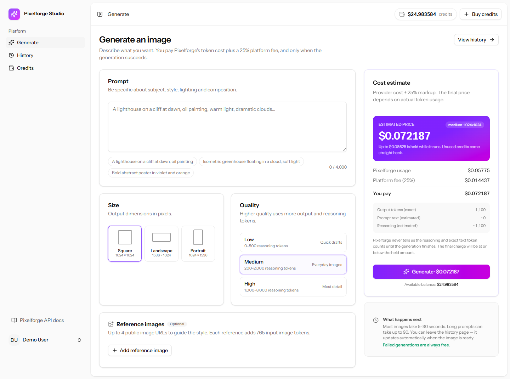
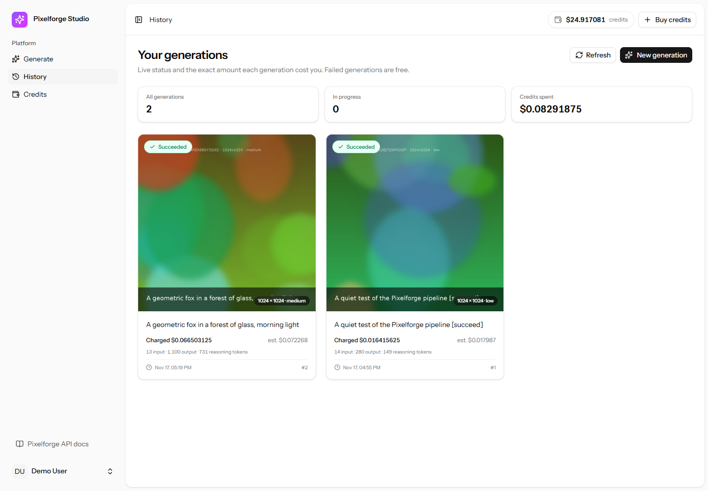
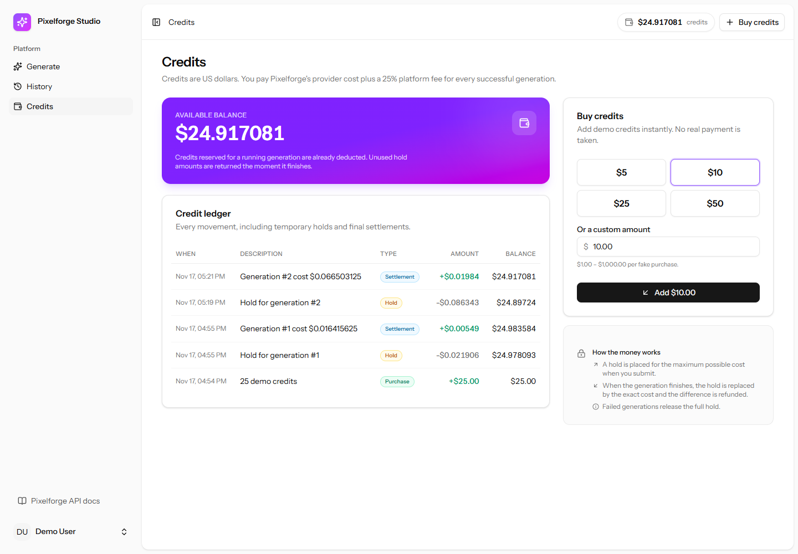
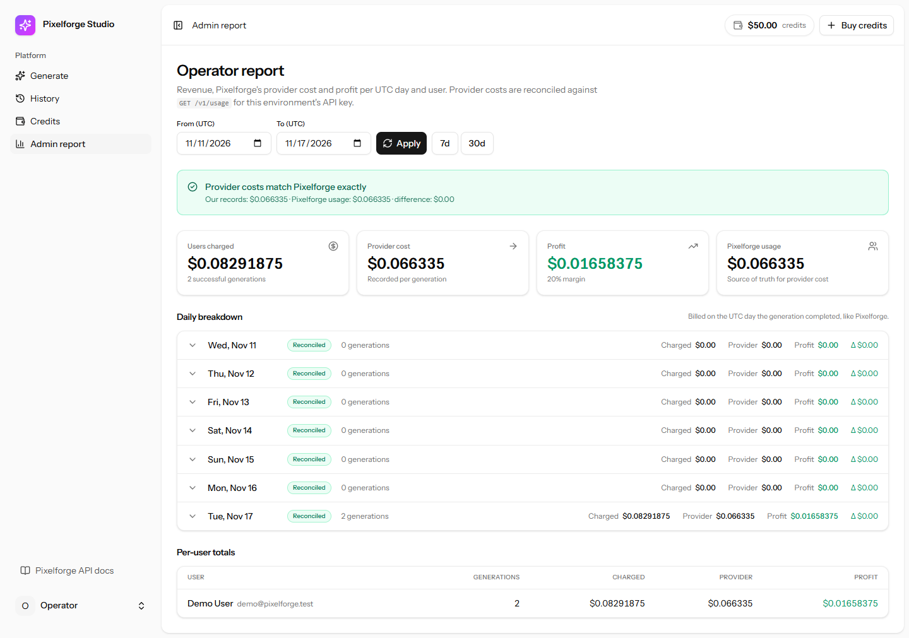
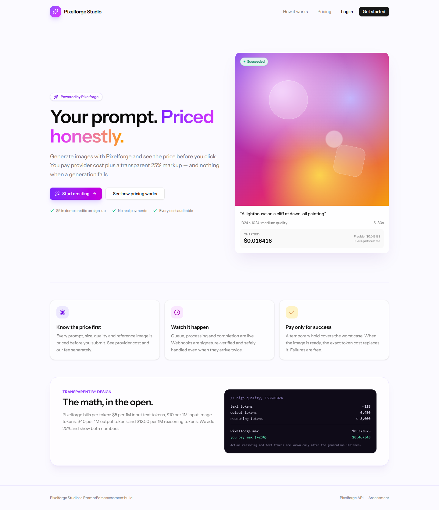

# Pixelforge Studio

A Laravel + Vue + Inertia image-generation app built for the PromptEdit take-home assessment.

Users sign in, write a prompt, choose a size/quality and optional reference images, see the price **before** submitting, and watch the generation move from queued to succeeded or failed. Every successful generation is charged at Pixelforge's exact token cost plus a 25% markup. Failed generations are free.



## Live demo

- App: `https://<your-deployment>` (see [DEPLOYMENT.md](DEPLOYMENT.md))
- Pixelforge account email: `<the email used to create the Pixelforge key>`
- User account: `demo@pixelforge.test` / `password`
- Operator account: `admin@pixelforge.test` / `password` (includes the admin report)
- New registrations receive **$5.00** of demo credits automatically.
- "Buy credits" is a fake purchase; no payment provider is involved.

## What is included

### Required

- **Generate** page with prompt, three sizes, three qualities, up to four reference-image URLs, live price estimate and a clear breakdown of Pixelforge cost vs. our 25% fee.
- **Pricing** based on Pixelforge's published token rates. Output and reference-image tokens are exact; text and reasoning tokens are only known after completion, so the UI shows an estimate and the maximum we hold.
- **History** with live status (polling while anything is in flight), image, estimated cost, exact actual cost, token usage and a friendly error when a generation fails.
- **Webhooks** at `POST /webhooks/pixelforge` with HMAC-SHA256 signature verification (raw body + timestamp), replay protection, event-id deduplication, out-of-order protection and a polling fallback for missed deliveries.
- **Queue-based submission** with `Idempotency-Key`, Retry-After-aware exponential backoff, and safe retries for overloads/rate limits. Permanent failures release the full hold.

### Stretch goals

- **Admin report** (`/admin/report`) with revenue (what users were charged), provider cost (what Pixelforge charged us), profit and margin per UTC day and per user. It fetches `GET /v1/usage` for the same range and shows a live reconciliation with the delta.
- **Balances**: a real credit ledger, temporary holds, settlement/refund entries, "Buy credits", and server-side blocking when the balance cannot cover the maximum possible cost.

## Screens

| History                              | Credits                              |
| ------------------------------------ | ------------------------------------ |
|  |  |

| Admin report                            | Landing page                         |
| --------------------------------------- | ------------------------------------ |
|  |  |

## How the money works

All money is stored as integer **picodollars**: `1 USD = 1,000,000,000,000` picodollars. Pixelforge reports costs to 9 decimal places, so a 12-decimal integer representation keeps both the provider cost and the 25% markup exact. No floats are used in the money path.

For a succeeded generation:

```
provider_cost = Σ (tokens_of_type × rate_per_1M / 1,000,000)
charged       = provider_cost × 1.25
```

The rates come from the `rates` object on the generation itself (Pixelforge freezes them at creation), not from our cached pricing endpoint. That is what makes the recorded provider costs match `GET /v1/usage` exactly.

The lifecycle of a generation:

1. **Estimate.** `ceil(prompt_characters / 4)` text tokens, 765 tokens per reference image, the exact output token count for the chosen quality/size, and the midpoint of the reasoning-token band. This is the price shown in the UI.
2. **Hold.** The documented worst case is held (text tokens +15%, maximum reasoning tokens) so the balance can never be overspent while a generation is running.
3. **Settle.** On success, the exact cost is computed from actual `usage` and the generation's fixed `rates`, the user is charged `cost × 1.25`, and the unused hold is returned in the same ledger transaction.
4. **Failure.** The full hold is released, the provider cost and user charge are both recorded as `0`, and nothing is billed.

The credit ledger has `hold` and `settlement` rows per generation with a unique `(generation_id, type)` index. Combined with `settled_at` and a row lock, this makes it impossible for a duplicated or replayed webhook to move money twice.

## Webhook correctness

Pixelforge delivers at least once, in any order, and sometimes before our `POST /v1/generations` call returns. The implementation handles all of that:

- Signature is verified against the **raw request body** using `hash_hmac('sha256', "{timestamp}.{body}", secret)` and `hash_equals()`. Requests older than five minutes are rejected.
- The event id is stored in `pixelforge_events` with a unique index. A duplicate event returns `204` and does no work.
- The local generation is matched by `pixelforge_id`, or - if the webhook beat the create response - by the `metadata.generation_id` we send to Pixelforge.
- Status transitions are monotonic (`queued → processing → succeeded/failed`). A delayed `processing` event cannot move a final generation backwards; contradictory final states are ignored.
- Settlement is guarded by `settled_at`, the generation row lock and the unique ledger index.
- `pixelforge:poll` runs every minute to recover missed webhooks and any succeeded-but-unsettled rows. Webhook failure therefore never means money is lost.

Event processing is transactional: the event row is only committed if the state change commits. A processing error returns `500` so Pixelforge retries, rather than acknowledging an event we did not apply.

## Submission robustness

- Every create request is queued, so the HTTP response never waits for Pixelforge.
- A UUID `Idempotency-Key` is generated before submission and reused on every retry, including network failures.
- `429` and `503` respect `Retry-After`; retries back off (2s, 4s, 8s … capped at 60s) for up to 8 attempts.
- `content_policy_violation`, `validation_failed` and `daily_limit_exceeded` are not retried; the generation is marked failed with a user-friendly message and the hold is released.
- `pixelforge:poll` also re-dispatches stuck submissions if a queue worker was unavailable.
- `[blocked]`, `[fail]`, `[slow]`, `[duplicate]` and `[succeed]` from the Pixelforge docs were used to exercise these paths.

## Admin reconciliation

Provider cost is attributed to the **UTC day the generation completed**, exactly like `GET /v1/usage`. The report queries Pixelforge for the selected range and displays:

- our recorded provider cost,
- Pixelforge's reported cost,
- the difference per day and in total,
- a green/red "Reconciled" state.

On the local build the two totals matched exactly (`$0.066335000` after two successes); the screenshot above shows the reconciliation panel.

## Stack

- Laravel 13, PHP 8.4
- Inertia.js 3 + Vue 3 + TypeScript
- Tailwind CSS 4 / shadcn-style components
- Laravel Fortify authentication
- Database queue + scheduler (SQLite locally, PostgreSQL in production)
- PHPUnit feature/unit tests

## Local setup

Requirements: PHP 8.3+ with `bcmath`, Composer, Node 20+, and SQLite (or another Laravel-supported database).

```bash
composer install
cp .env.example .env          # Windows: copy .env.example .env
php artisan key:generate
php artisan migrate --seed
npm install
npm run build                 # or: npm run dev

# three terminals
php artisan serve
php artisan queue:work --sleep=2 --tries=8 --timeout=60
php artisan schedule:work
```

Set these in `.env`:

```dotenv
PIXELFORGE_BASE_URL=https://pixelforge.promptedit.dev/v1
PIXELFORGE_API_KEY=pf_...
PIXELFORGE_WEBHOOK_SECRET=whsec_...
PIXELFORGE_MARKUP_BASIS_POINTS=2500
```

One Pixelforge key per environment is recommended: each key has its own webhook URL/secret and its own usage report.

### Webhooks locally

Pixelforge rejects `localhost` URLs, so expose the app with a tunnel:

```bash
cloudflared tunnel --url http://127.0.0.1:8000
# or: ngrok http 8000
```

In the Pixelforge dashboard, set the key's webhook URL to:

```
https://<tunnel-or-domain>/webhooks/pixelforge
```

Copy the key's `whsec_...` signing secret into `PIXELFORGE_WEBHOOK_SECRET`. The endpoint is excluded from CSRF protection in `bootstrap/app.php`, as Pixelforge cannot send a CSRF token.

## Tests

```bash
php artisan test
vendor/bin/pint --test
vendor/bin/phpstan analyse --memory-limit=1G
npm run types:check
npm run check
```

The test suite covers:

- exact picodollar conversion, token costs, markup and the docs' worst-case worked example,
- hold/insufficient-balance behavior,
- duplicate success webhooks (same and different event ids) charging exactly once,
- out-of-order `processing` events after success,
- failed generations releasing the hold and costing nothing,
- a webhook arriving before the create response (matched via metadata),
- invalid signatures,
- admin report reconciliation and mismatch surfacing,
- fake credit purchases and validation.

## Deployment

The repo includes a production `Dockerfile` (Apache + PHP 8.4, multi-stage Node asset build) and role-based startup (`ROLE=web|worker|scheduler`). See [DEPLOYMENT.md](DEPLOYMENT.md) for Laravel Cloud, Railway and VPS instructions.

## Design decisions and trade-offs

- **Hold the maximum, show the midpoint.** The UI shows a realistic estimate, but the balance check uses the documented maximum so a user can never spend the same dollar twice. The difference is refunded at settlement.
- **Store charged amounts, do not recompute them.** `charged_amount` is persisted per generation. Admin revenue is a sum of stored charges, so later markup or rate changes never rewrite history.
- **Use the provider's frozen rates.** The pricing endpoint is only for estimates; actual cost uses the generation's `rates` snapshot.
- **Do not store images.** The brief allows expired Pixelforge URLs. Downloading and storing images would be the next step for a real product.
- **Email verification is disabled for the demo.** Otherwise reviewers could not sign in without a mail provider. New accounts get $5 of demo credits.
- **Operator access is an `is_admin` flag.** The seeded operator account is intentionally public for the assessment; a real deployment would use invitations/roles.
- **Webhook work is synchronous and transactional.** It is one indexed lookup plus one row update, well under Pixelforge's 10-second response budget. If the volume grew, the same handler could be moved behind a queue using `pixelforge_events` as the inbox.
